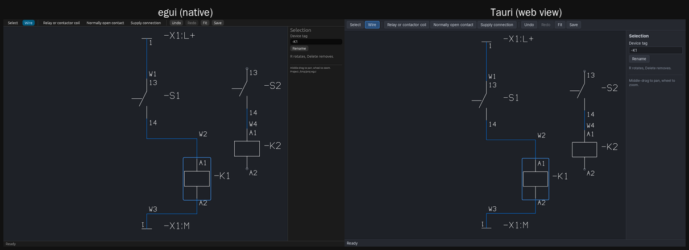

# M1b: choosing the editor's UI technology

**Decision (25 Nov 2026, owner): egui.** The canvas is where users spend their time, and egui
draws it in the same process as the model with nothing to serialise or send, so it stays fluid
on dense pages without extra engineering. Accepted cost: forms and tables (properties, parts,
reports) are plainer and take more work than HTML would. The Tauri shell was removed after
the decision; the comparison below is kept as the record of why.

---

Both shells are thin layers over the same `ecad_editor::Session`: they forward input and paint
the `Frame` they get back. Tools, snapping, hit-testing, undo, pan/zoom and saving are shared
code, so the two behave identically. The choice is only about the window around the editor.



*Same scripted session in each: place -K2 and -S2, wire them (W4), drag -K1 (its wires reroute
live), switch to the Wire tool.*

## Try it

```sh
cargo run -p ecad-app -- ~/ElectricStudio/Sample
```

Without a folder argument it opens `~/ElectricStudio/Sample`, creating the sample project there
if needed.

| Action | Input |
| --- | --- |
| Select, move | Click, drag (snaps to the 4 mm grid) |
| Rotate, delete | R, Delete |
| Place a symbol | Toolbar symbol button, then click |
| Draw a wire | W (or Wire), click a connection point, then another |
| Undo, redo, save | Ctrl+Z, Ctrl+Y (or Ctrl+Shift+Z), Ctrl+S |
| New, open project | Ctrl+N, Ctrl+O (or the File menu); asks before discarding changes |
| Pan, zoom, fit | Middle-drag, wheel, F |
| Edit tag, description, wire number | Select, edit in the right panel; applied when the field loses focus (Enter, Tab or a click) |

## Comparison

| | egui | Tauri |
| --- | --- | --- |
| How it draws | In-process, every frame from the Rust data | Page sent to a web view as JSON, drawn on a canvas |
| Data per page change | None (same process) | ~10 KB for the sample page; a dense page will be hundreds of KB per drag step, so it will need incremental or binary updates |
| Panels, forms, tables (properties, parts, reports) | Workable, plainer look, all in Rust | HTML/CSS: richer and faster to style; fits the HTML prototypes already made for HMI Studio |
| Code in a second language | None | HTML/CSS/JS (or TypeScript/React later) |
| Linux runtime needs | OpenGL | WebKitGTK (on Ubuntu desktop by default) |
| Windows runtime needs | OpenGL | WebView2 (built into Windows 10/11) |
| Same stack as HMI Studio | No | Yes (Tauri 2) |
| Cold build on CI | Smaller | Larger (WebKitGTK headers, more crates) |

## Recommendation made before the decision

**Tauri**, with one condition. Most of the product's remaining screens are forms and tables:
properties, parts catalogue, reports, terminal plans, project structure. HTML does those
better and faster, and it matches HMI Studio's stack and the HTML prototypes you already
like. The cost is the canvas data path: before large pages, the page must move to the web view
incrementally (only what changed) or in a binary form. That's planned work for M1c.

Choose **egui** instead if you'd rather keep the whole product in Rust and value the canvas
being in-process over richer panels.

Both shells looked and behaved the same on the sample page. Asked which would be more fluid,
the answer was egui (no per-change transfer; WebKitGTK on Linux is also slower than WebView2),
and egui was chosen.
